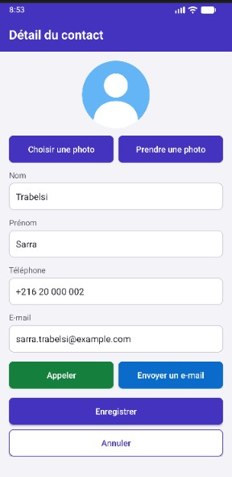
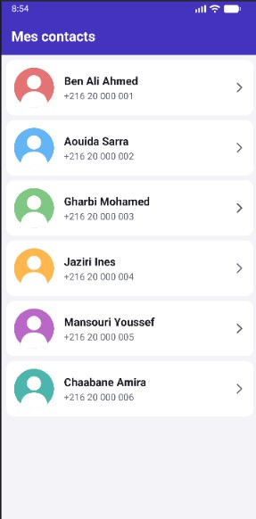
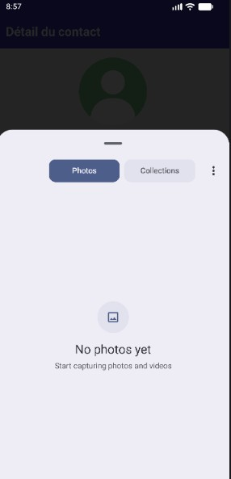
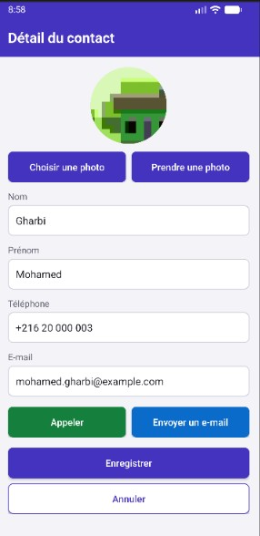
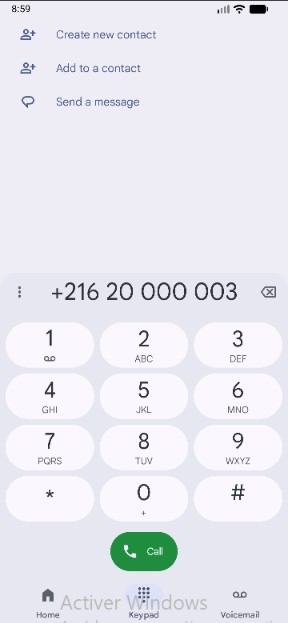

# Liste de contacts (version 2) — TP Android

Application Android en Kotlin avec deux activités. `MainActivity` affiche les contacts dans une `ListView` personnalisée. `DetailActivity` permet de modifier un contact, de l'appeler, de lui envoyer un e-mail et de changer sa photo depuis la galerie ou la caméra.

## Lancer le projet

1. Dans Android Studio, choisir **File > Open** puis sélectionner le dossier du projet.
2. Attendre la fin de la synchronisation Gradle.
3. Choisir un émulateur ou un téléphone (Android 7.0 ou plus récent), puis cliquer sur **Run ▶**.

**Configuration :** Kotlin, View Binding, Android Gradle Plugin 9.4.1, Gradle 9.6.0, compileSdk 37, minSdk 24.

## Organisation

| Élément | Emplacement |
|---|---|
| Code Kotlin | [`app/src/main/java/com/example/contactsv2/`](app/src/main/java/com/example/contactsv2/) |
| Interfaces XML | [`app/src/main/res/layout/`](app/src/main/res/layout/) |
| Captures d'écran | [`captures/`](captures/) |
| Compte rendu | [`compte-rendu/`](compte-rendu/) |

## Captures d'écran

