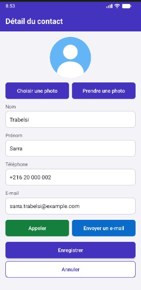
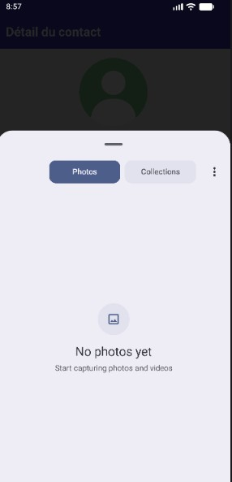
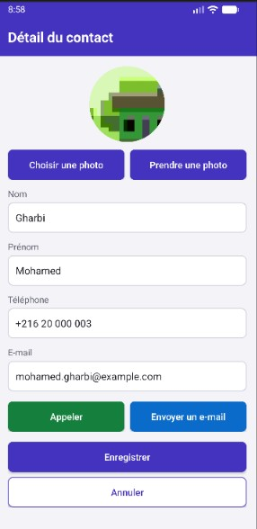
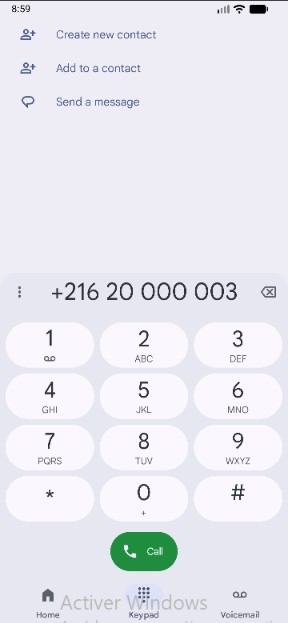

# Compte rendu : liste de contacts (version 2)

**Étudiante :** Basmala Aouida

## 1. Travail réalisé

L'application comporte deux activités :

- **`MainActivity`** affiche six contacts dans une `ListView` personnalisée, avec la photo, le nom, le prénom et le téléphone.
- **`DetailActivity`** permet de modifier le contact, de l'appeler, de lui envoyer un e-mail et de changer sa photo.

## 2. Principales étapes

1. **Modèle :** `Contact` contient le nom, le prénom, le téléphone, l'e-mail et la photo. `versBundle()` et `depuisBundle()` le transmettent dans les Intents.
2. **Liste :** `ContactAdapter` étend `ArrayAdapter<Contact>` et remplit la ligne `item_contact.xml`.
3. **Ouverture du détail :** un Intent explicite transmet la position et les données du contact.
4. **Appel et e-mail :** deux Intents implicites, `ACTION_DIAL` avec `tel:` et `ACTION_SENDTO` avec `mailto:`.
5. **Galerie :** le contrat `PickVisualMedia` ouvre le sélecteur de photos.
6. **Caméra :** le contrat `TakePicture` enregistre la photo dans un fichier partagé par un `FileProvider`, après demande de l'autorisation `CAMERA`.
7. **Photos :** `PhotoUtils` copie chaque photo dans le stockage de l'application, en la réduisant et en corrigeant son orientation.
8. **Retour de résultat :** `registerForActivityResult` reçoit le contact modifié. `MainActivity` met à jour la liste et appelle `notifyDataSetChanged()`.

## 3. Situations gérées

| Situation | Comportement |
|---|---|
| Champ obligatoire vide | Erreur affichée dans le champ, pas d'enregistrement |
| Téléphone ou e-mail invalide | Erreur affichée dans le champ |
| Annulation de la sélection ou de la prise de photo | Message, et la photo actuelle est conservée |
| Photo illisible | Message, et la photo actuelle est conservée |
| Aucune application compatible | Message, sans plantage (`ActivityNotFoundException`) |
| Autorisation de la caméra refusée | Message |
| Aucune caméra disponible | Message |
| Bouton Annuler ou retour | Retour à la liste sans modification |

## 4. Tests effectués

| Test | Résultat attendu |
|---|---|---|
| Modifier un contact puis enregistrer | Liste mise à jour immédiatement | 
| Bouton Appeler | Composeur ouvert avec le numéro |
| Bouton Envoyer un e-mail | Messagerie ouverte avec l'adresse | 
| Choisir une photo dans la galerie puis enregistrer | Photo mise à jour dans le détail et la liste | 
| Prendre une photo puis enregistrer | Photo mise à jour dans le détail et la liste | 
| Modifier puis annuler | Anciennes données inchangées | 
| Vider un champ puis enregistrer | Erreur et pas d'enregistrement | 
| Annuler le choix de photo ou la caméra | Photo actuelle conservée | 
| Refuser l'autorisation de la caméra | Message, sans plantage |

## 5. Captures d'écran

